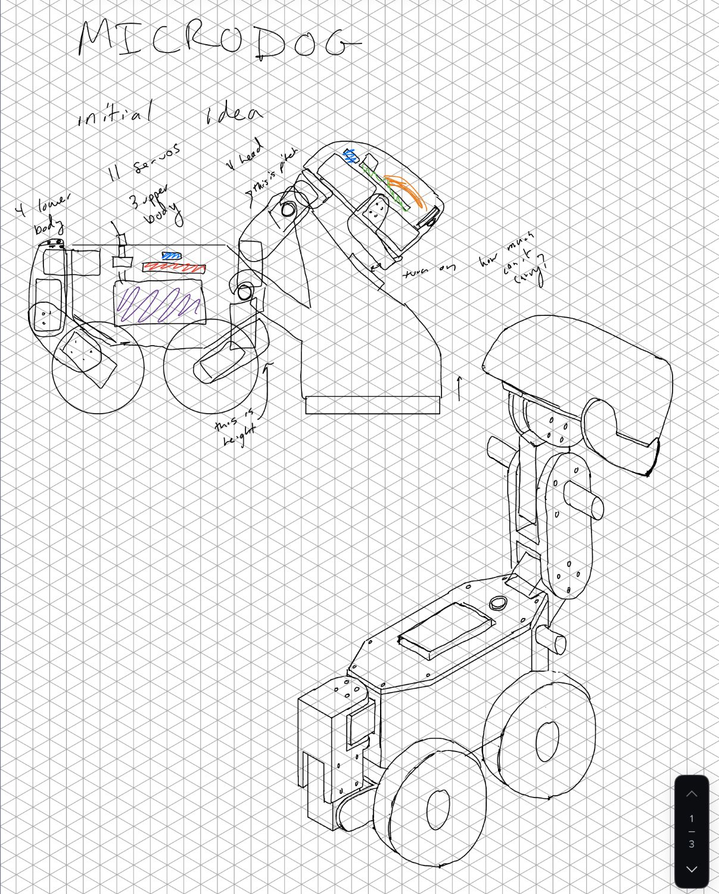
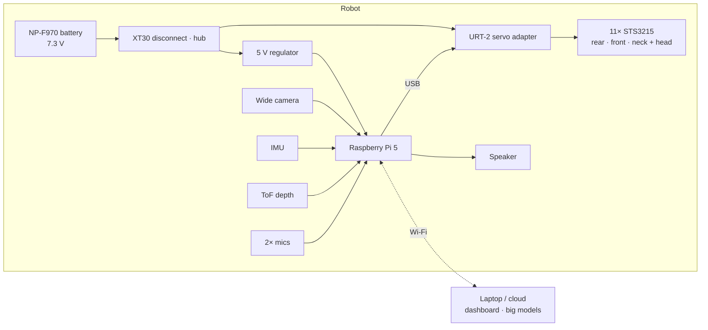

# Microdog

**A small open-source wheeled robot with a long neck and a busy head. It picks up attachments like a broom, a mop or a vacuum, and does real chores with them.**

Early hand sketch. It gets replaced by CAD renders as parts are approved.

Microdog is a hobbyist robot you can build from off-the-shelf parts and a 3D printer (PETG on a Bambu Lab P1S). It takes inspiration from Pollen Robotics' Microduck, but it rolls on wheels instead of walking. It steers from the back like a forklift and spends its 11 servos on **height, reach and expression**. Pegs on its body let it hook onto attachments, lift them by moving its neck or body height, and sweep, mop or vacuum. You can tell it what to do, or let it notice a mess on its own.

> **Status: design phase (November 2026).** The concept, power system and parts list are written down. CAD is starting with the body, one approved part at a time ([CAD plan](docs/cad-plan.md)). There's no code or printable part yet. Watch or star the repo to follow along.

## Why it's interesting

- **Tools, not tricks.** Peg-mounted attachments turn a cute desk robot into one that does chores. New attachments are just printed parts.
- **One cable for 11 motors.** Every joint is a Feetech STS3215 serial bus servo. They daisy-chain on one bus, and each one reports its position, load, voltage and temperature.
- **A real Linux brain.** A Raspberry Pi 5 runs the camera, sensors, audio and small vision models. Heavier models can run on a laptop or the cloud over Wi-Fi.
- **Sim-ready CAD.** The same CAD that makes the printed parts also exports a robot model with real masses and joint limits, for training policies in simulation.
- **Assembly you can trust.** Step-by-step build instructions are generated from the CAD and checked for collisions before anyone prints.
- **Designed in the open.** Every CAD decision is written down and approved before the next part starts, so you can see *why* it looks the way it does.

## How it fits together

More detail: [concept](docs/concept.md) · [the brain](docs/architecture.md) · [power](docs/power.md) · [wiring](docs/wiring.md).

## Repo map

| Folder | What's inside |
|---|---|
| [`docs/`](docs/) | How the robot works and why. **Start with [`docs/README.md`](docs/README.md).** |
| [`hardware/`](hardware/) | Bill of materials ([`bom.csv`](hardware/bom.csv)), sketches and photos. |
| [`cad/`](cad/) | Code that generates every printed part. Parts land here once approved. |
| [`software/`](software/) | Python that runs on the Pi. Modules land here once they work on hardware. |

## Roadmap

| Step | State |
|---|---|
| Concept, power design, parts list | ✅ Done |
| CAD: body → rear → front → neck → head | 🚧 Starting ([plan](docs/cad-plan.md)) |
| Electronics bring-up: Pi, servo bus, camera, IMU, audio | 🔜 Parts arriving ([checklist](docs/bring-up.md)) |
| Driving and teleop | 🔜 |
| First attachment (broom) | 🔜 |
| Autonomy: spot a mess, fetch the right tool | 🔜 |

## Contributing

Issues and pull requests are welcome, especially answers to [open questions](docs/open-questions.md), cheaper or easier-to-find parts, and attachment ideas.

House rule: **don't invent pinouts, servo IDs or dimensions.** If it hasn't been measured or decided, mark it `TBD`.

## License

[MIT](LICENSE).
