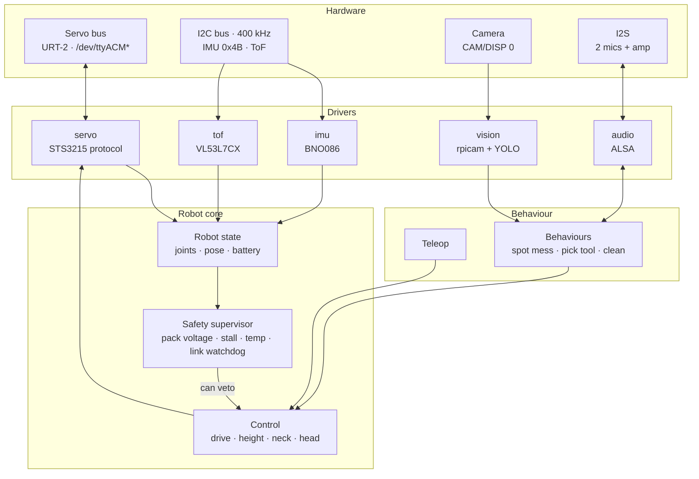
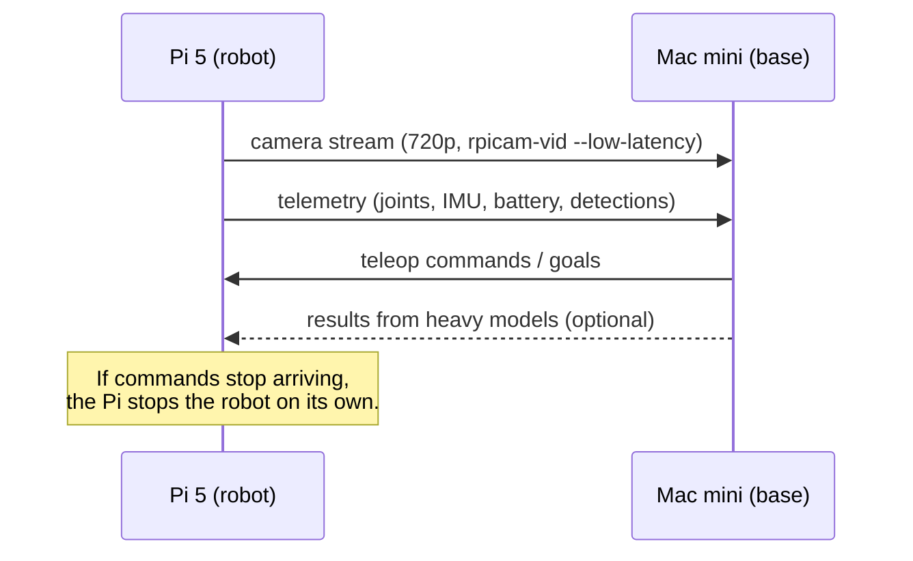

# Architecture: how the brain works

Microdog splits its thinking in two:

- **On the robot (Raspberry Pi 5):** everything that has to be fast or keep working without Wi-Fi. That covers talking to servos and sensors, safety limits, small vision models, and audio in and out.
- **Off the robot (Mac mini or cloud):** everything heavy or nice-to-have. That covers the dashboard, recordings, larger vision or language models, and training.

The robot must always stay safe if the Wi-Fi link drops. Losing the link means stop, not keep going.

## Layers on the Pi

| Layer | Job | Status |
|---|---|---|
| Drivers | One module per device. They hide wire protocols and give plain Python values. | Planned |
| Robot state | One snapshot of joints, IMU pose, battery and sensor readings, updated in a loop | Planned |
| Safety supervisor | Cuts torque or stops wheels on low pack voltage, sustained stall load, over-temperature or a lost link | Planned (limits below) |
| Control | Turns "drive at 0.1 m/s, body up 1 cm, lift the attachment" into servo commands using the [servo map](servo_map.md) | Planned, after the joint map is final |
| Teleop and behaviours | A human with a gamepad or web page, or an autonomous behaviour such as "see crumbs, fetch the broom, sweep" | Planned |

### Safety limits (starting values, to be tuned on hardware)

| Check | Starting value | Why |
|---|---|---|
| Pack stop under load | **6.8–7.0 V** | Keeps the 5 V regulator above dropout (it needs about 5.7–6.5 V in), so the Pi doesn't brown out mid-motion |
| Wheel torque limit | ~40 % | Gentle on gears and furniture during bring-up |
| Stall | Stop a wheel if load stays high for ~0.3 s | Stops it grinding against an obstacle or burning out a servo |
| Servo over-voltage register | 8.8–9.0 V | A full pack (8.4 V) plus regenerative braking must not trip the alarm |
| Link watchdog | Stop motion if teleop is silent for TBD ms | Wi-Fi drops shouldn't mean a runaway robot |

## Robot ↔ base station

## Compute budget on the Pi 5

The Pi 5 has **no hardware H.264 encoder**, so video streaming and vision share the CPU.

| Task | Expectation | Notes |
|---|---|---|
| YOLOv8n / YOLO11n on CPU | ~5–10 fps at 320–640 px | Faster when exported to NCNN or ONNX. Enough to spot a mess or an attachment and steer slowly. |
| 720p stream encode | Significant CPU share | Turn it off when not watching |
| If vision is too slow | Stream to a laptop, or add a Raspberry Pi AI HAT+ (Hailo) | The HAT+ is optional and not part of v1 |

Measure, don't guess: [`bring-up.md`](bring-up.md) has a YOLO benchmark step that records fps, model size and CPU use.
