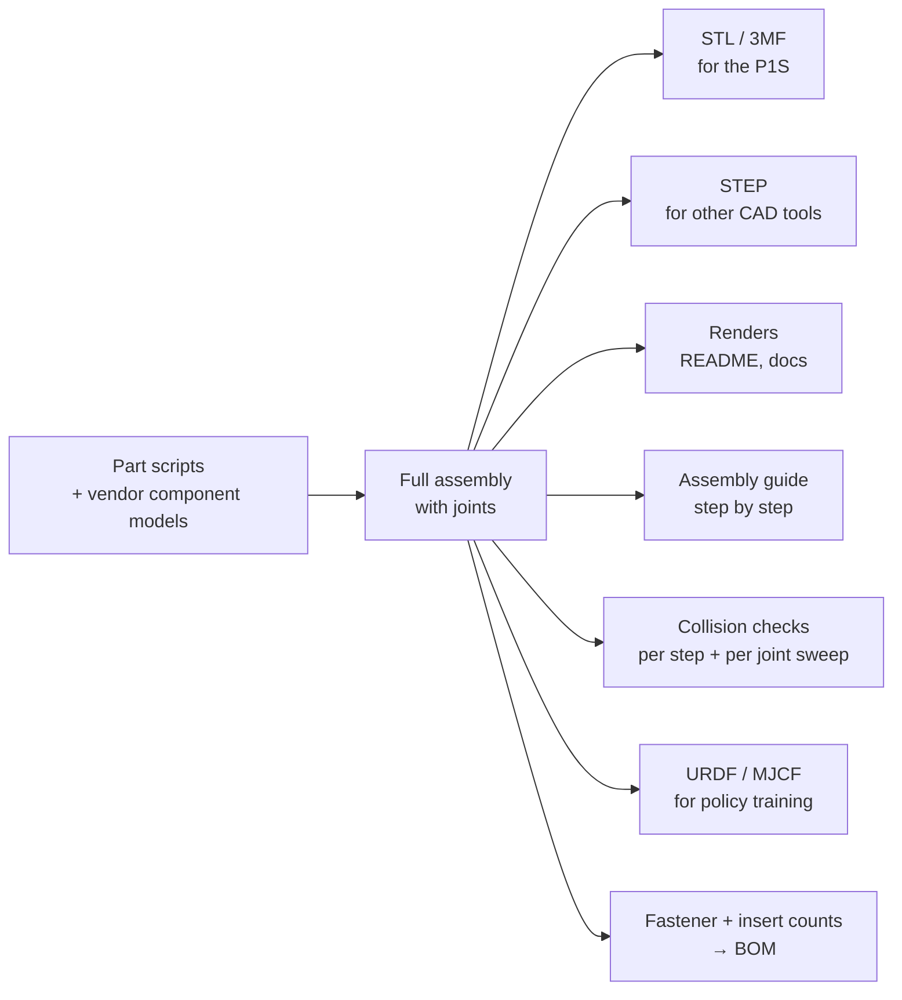
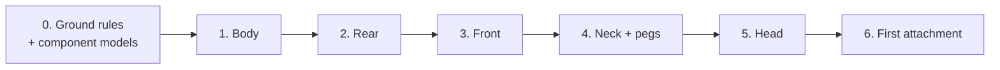

# CAD plan

Microdog's parts are designed **one at a time, with an approval at every gate**. Mistakes made early, like a wrong servo pocket or a battery that doesn't fit, get expensive once other parts are built around them. Small steps catch them while they're still cheap. Each part also teaches something that makes the next one better, so lessons go in the [decision log](#decision-log).

## What the CAD has to deliver

The CAD isn't just printable parts. One source of truth produces all of this:

| Requirement | What that means in practice |
|---|---|
| **Real component models** | The Pi 5 with cooler, STS3215s, URT-2, regulator, battery and plate, camera, IMUs, speaker and so on are placed as their real 3D models (vendor STEP files, or modelled from calipers where none exist). Fit is proven against the real thing. |
| **Professional look** | Consistent wall thickness, fillets, hidden fasteners where possible, one colour scheme. Renders are good enough for the README. |
| **Assembly instructions** | An ordered list of steps generated from the CAD. Each step has an exploded render, its parts and fasteners, and a note on tool access. Each step is checked automatically: no part overlaps another, and each part has a clear path to drop in. |
| **Collision-free motion** | Every joint is swept through its full range, alone and in combination with its neighbours, with collisions reported. Joint limits come from this sweep. |
| **Sim-ready** | Every printed part has a material (PETG density) so mass and inertia are computed; bought parts use measured masses. Joints have axes, limits and servo torque and speed. The export is a URDF and/or MJCF with simplified collision meshes, so a policy trained in sim matches the real robot. |

## Order

The body comes first because everything else bolts to it. Then work rearward to finish the base, then forward and up to the head.

| # | Part | Holds / does | Servos |
|---|---|---|---|
| 0 | Ground rules + component library | Decisions below, plus a model of every bought component, checked against calipers | — |
| 1 | Body | Battery bay and plate, URT-2, body IMU, regulator, switch, fuse, power hub, wire paths, and the mounting interfaces for rear, front and neck | — |
| 2 | Rear | Hip (yaw steering), leg (pitch), 2 wheels and tyres | 11–14 |
| 3 | Front | Leg (pitch), 2 wheels and tyres | 21–23 |
| 4 | Neck + pegs | Neck pitch joint, neck structure, pegs and the peg spec attachments follow, cable routing to the head | 31 |
| 5 | Head | Head pitch, head yaw, jaw, camera, head IMU, mics, speaker, ToF, and the Pi if it lives here | 32–34 |
| 6 | First attachment | A broom that hooks onto the pegs. This proves the whole idea. | — |

After each part is approved, the full-robot assembly guide, collision checks and sim model are regenerated, so they're always current for the parts that exist.

## The loop for every part

Each part goes through four gates. **Nothing moves to the next gate without an explicit approval.**

| Gate | What gets made | What gets reviewed |
|---|---|---|
| **A · Brief** | A short page: what the part must do, which components and joints it holds, hard constraints (measured dimensions only), 2–3 options with trade-offs, and a recommendation | Pick an option, fix anything misunderstood. **No geometry yet.** |
| **B · Block-out** | Simple shapes around the **real component models**, with joint axes and range of motion | Renders from the standard views, overall size, centre of mass, joint sweep with no collisions |
| **C · Detail** | Real features: servo pockets, insert bosses, wire channels, fillets, print orientation. Plus this part's assembly steps. | Renders, section cuts through every mating feature, a key-dimension table with sources, per-step collision check results, mass and inertia, print time and filament estimate |
| **D · Print + fit** | **Test coupons first** for anything risky (servo pocket, insert boss, peg fit), then the part | Photos, assembly following the generated steps, what fit and what didn't |
| **Graduate** | Script, exports and assembly steps move from `internal/` into `cad/`. BOM, servo map and decision log are updated. | — |

### Rules that keep mistakes small

- **Real numbers only.** Every dimension comes from a vendor model, a datasheet, a caliper measurement or an approved decision, and its source is written next to it. Anything else is `TBD` and stops the gate.
- **One part per review.** Don't start the next part's geometry while the current one is waiting.
- **Same views every time** (iso, front, side, top, plus sections) so reviews are quick to compare.
- **Interfaces get named.** Where two parts meet (for example "rear hip mounting face"), the interface is defined once in the earlier part and reused by the later one, not re-guessed.
- **Prove assembly on the printed part.** If the physical build needs a step the generated guide doesn't have, the guide is wrong. Fix it before graduating.

## Step 0: ground rules

| Decision | Choice | Status |
|---|---|---|
| Printer | Bambu Lab P1S. Build volume 256 × 256 × 256 mm sets the largest single part. | ✅ Decided |
| Material | **PETG**. It handles sun and heat better than PLA and is tougher for pegs and mounts. | ✅ Decided |
| Fasteners | **Heat-set inserts** (brass, M2 and M3) for printed-to-printed joints and anything taken apart more than once. Servos keep their own self-tapping screws. | ✅ Decided |
| Servo layout | 11× STS3215: rear 4 (hip yaw, leg pitch, 2 wheels), front 3 (leg pitch, 2 wheels), neck and head 4 (neck pitch, head pitch, head yaw, jaw). See [servo_map.md](servo_map.md). | ✅ Decided |
| Overall size | Microduck-like, and as small as fits every BOM component. The body block-out sets the real number. | ✅ Decided (approach) |
| CAD tool | **build123d** (Python). Imports vendor STEP files, gives exact collision checks on the OpenCASCADE kernel, has built-in joints for the URDF/MJCF export, and keeps every change reviewable as text. | ✅ Decided |
| 3D review | Live [OCP CAD Viewer](https://github.com/bernhard-42/vscode-ocp-cad-viewer) in a browser: orbit, zoom, pan, section clipping, measuring, and a parts tree to hide or show components. Every gate review happens in it. | ✅ Decided |
| Insert sizes and hole specs | Set by a test coupon on the P1S in PETG | ⏳ Coupon print |
| Fit tolerances | Servo pocket and peg clearance, from the same coupon | ⏳ Coupon print |
| Payload | Heaviest attachment it must lift or push | ⏳ TBD |
| Wheels | Diameter, tyre (printed TPU or bought), direct on the servo horn | ⏳ Decided in part 2 |
| Pi location | **Head.** The camera ribbon is the most fragile and hardest cable to route, so it stays short. Power, USB to the URT-2, the servo chain and the body IMU's I2C run through the neck instead. | ✅ Decided |

### Component library to collect

Each needs a 3D model plus a measured mass. Vendor files go in `cad/vendor/` with their source and license noted. Any that can't be redistributed get a download script instead.

| Component | Model source | Mass |
|---|---|---|
| Feetech STS3215 | Vendor STEP | TBD |
| Raspberry Pi 5 + Active Cooler | Raspberry Pi STEP | TBD |
| Camera Module 3 Wide | Raspberry Pi STEP | TBD |
| URT-2 adapter (CH343, USB-C, dual TTL + RS485) | Model from calipers | TBD |
| Pololu D24V50F5 | Pololu drawing | TBD |
| NP-F970 battery | Model from calipers | TBD |
| NP-F battery plate | Model from calipers. Listing: ~100 × 90 × 15 mm, 4 corner holes on a 75 mm VESA square. | ~49 g (listing) |
| IMU ×2 (body, head) | Depends on the model of the two IMUs on hand | TBD |
| VL53L7CX breakout | Once chosen | TBD |
| INMP441, MAX98357A, speaker | Model from calipers | TBD |
| Rocker switch, fuse holder, WAGO 221 | Vendor or calipers | TBD |
| Heat-set inserts, screws | Datasheet | — |

## Decision log

Every approved decision goes here, newest at the bottom, with what was learned.

| Date | Part / gate | Decision | Why / lesson |
|---|---|---|---|
| 2026-11-20 | Plan | Body first, then rear, front, neck, head; four gates per part | Approving one part at a time catches mistakes early |
| 2026-11-20 | Step 0 | P1S, PETG, heat-set inserts | Heat and sun resistance; durable threads for repeated assembly |
| 2026-11-20 | Step 0 | Servo layout: rear 4 / front 3 / neck + head 4 | Forklift-style rear steering; height from the leg pitch joints |
| 2026-11-20 | Step 0 | Pi 5 goes in the head | The camera ribbon is the most fragile, hardest cable to route; sturdier cables go through the neck instead |
| 2026-11-20 | Step 0 | build123d for CAD, OCP CAD Viewer for reviews | Exact geometry for fit and collision checks, joints for sim export, diff-friendly; the viewer allows live rotate, zoom, pan and section views |
| 2026-11-20 | Step 0 | CAD must produce real-component fit checks, a generated assembly guide with collision checks, and a sim model | Prove the build works before printing; train policies on the same geometry |
