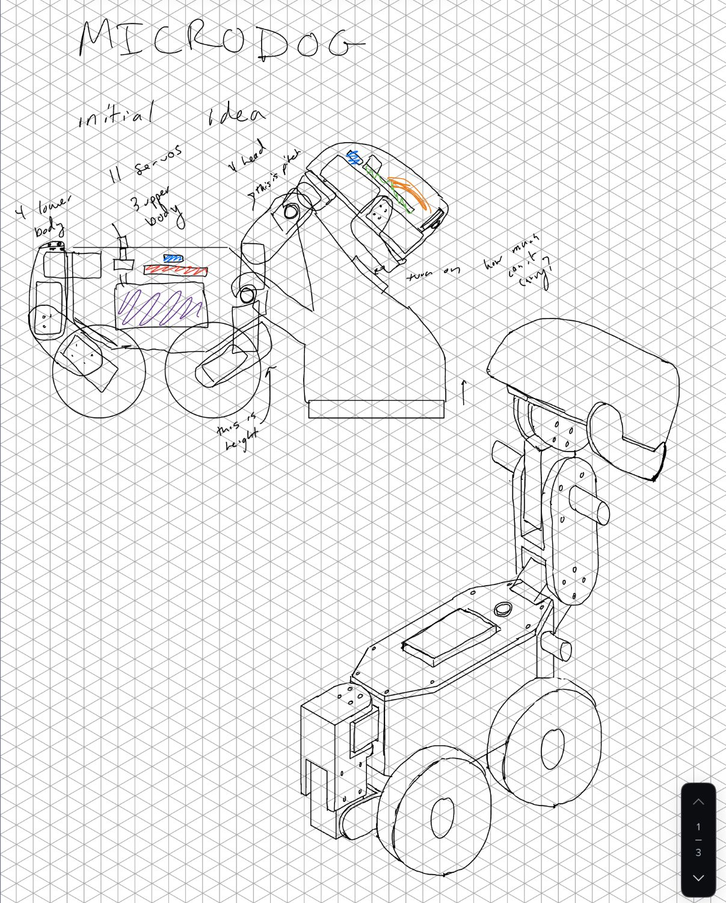

# Concept

*The first hand sketch (November 2026). Renders from the real CAD will replace it as each part is approved in the [CAD plan](cad-plan.md).*

## The idea

Microdog is a small wheeled robot with a long neck and an expressive head, inspired by Pollen Robotics' Microduck. Instead of walking, it rolls on four servo-driven wheels. It steers from the back like a forklift and uses its legs and neck for **height and reach**, so it can use tools.

**Attachments are the point.** Microdog has **pegs** on its sides, and attachments are made to hook onto them. It picks one up by lining up with it and lifting with its neck or legs. Once an attachment is on, the robot works it by moving its whole body:

| Attachment | How Microdog uses it |
|---|---|
| Broom / sweeper | Hook on, set the height so the bristles touch, drive |
| Mop pad | Hook on, press down with leg height, drive in passes |
| Small vacuum | Hook on, press its power button with the jaw, drive. Weight is the open question. |

It can be told what to do ("sweep the kitchen"), or notice a mess on its own with the camera and deal with it.

## The 11 servos

All 11 are the same Feetech STS3215.

| Group | Joint | Moves |
|---|---|---|
| **Rear (4)** | Rear hip | Yaw (left ↔ right). Steers the rear axle like a forklift. |
| | Rear leg | Pitch (forward ↔ back). Rear height. |
| | Rear-left wheel | Continuous rotation |
| | Rear-right wheel | Continuous rotation |
| **Front (3)** | Front leg | Pitch (forward ↔ back). Front height. |
| | Front-left wheel | Continuous rotation |
| | Front-right wheel | Continuous rotation |
| **Neck + head (4)** | Neck | Pitch (forward ↔ back) at the base of the neck |
| | Head pitch | Nod (forward ↔ back) |
| | Head yaw | Turn (left ↔ right) |
| | Jaw | Open / close. Also presses buttons. |

Raising or lowering the front and rear legs together changes the body height. Moving them separately tilts the body.

## Where things go (from the sketch)

These positions are a starting intent. Each one gets confirmed or changed in its part's brief.

| Component | Sketch location |
|---|---|
| Battery (NP-F970) | Body, low and central |
| URT-2 servo adapter | Body, above the battery |
| IMU #1 | Body |
| IMU #2 | Head |
| Raspberry Pi 5 | **Head (decided).** Keeps the fragile camera ribbon short. |
| Camera + ribbon cable | Head, with the ribbon running along the head |

## What it should feel like to build

- **Hobbyist-grade:** printable on a Bambu Lab P1S, with off-the-shelf parts and heat-set inserts. No machining.
- **Copyable:** every part comes with a link, a price and a reason in the [BOM](../hardware/bom.csv).
- **Provable:** step-by-step assembly instructions are generated from the CAD and checked for collisions.
- **Sim-ready:** the same CAD exports a robot model with real masses and joint limits for training policies.

## Questions the sketch raises

- How much can it carry? This sets servo torque, peg strength and wheel grip.
- How does an attachment stay on, and how does the robot let go of it?
- With the Pi in the head, what runs through the neck and how does it flex? See [open-questions.md](open-questions.md).
