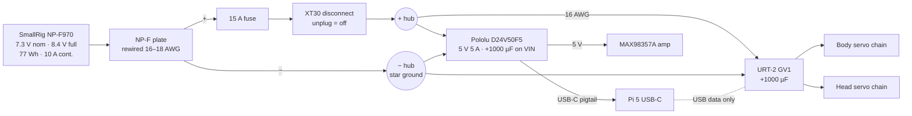

# Power

One removable camera battery runs everything. It feeds the servos at pack voltage and the Pi through a 5 V regulator.

**Charging:** plug a USB-C PD charger (36 W or more) into the battery's own USB-C port with the robot **switched off**. Running while charging is unproven, so don't leave it charging unattended inside the body.

## Grounding

- All high-current returns (servo chains, regulator) meet at **one point**: the negative hub.
- The URT-2's USB cable to the Pi is a second ground path. Keep servo return current off it: thick wires to the hub, and USB carries **data only**.

## Current budget

| Load | Estimate |
|---|---|
| 11 servos, normal driving | 1.5–5.4 A total (review estimate, unmeasured) |
| Pi 5 + camera + cooler | up to ~3 A at 5 V (regulator rated 5 A) |
| Pack limit | 10 A continuous, trips at 11 A |
| URT-2 servo path | described as a 6 A limit. Use two chains so one connector doesn't carry all 11 servos. |

## Bring-up checks: do these in order

1. **Meter the plate:** polarity and voltage, before connecting anything.
2. **URT-2 back-feed:** with the battery on and USB **unplugged**, meter the URT-2's USB VBUS pin. It must read **0 V**. If pack voltage appears there, do not plug it into the Pi.
3. **Raise servo over-voltage limits** to 8.8–9.0 V, one servo at a time:
   register 0x0E = 90; see [servo_map.md](servo_map.md#registers-worth-knowing).
4. **Regulator at no load:** confirm 5.0–5.1 V out.
5. **Pi alone on the regulator:** boot it and check for under-voltage warnings (`vcgencmd get_throttled` should be `0x0`).
6. **Tell the Pi it has a 5 A supply.** The regulator is not a USB-PD source, so the Pi assumes 3 A unless told:
   `sudo rpi-eeprom-config --edit` and add `PSU_MAX_CURRENT=5000`.
   **Only with the 5 A regulator.** Never set this on a weaker supply.
7. **One servo, then one chain, then both chains.** Log pack voltage and the Pi's `EXT5V_V` (`vcgencmd pmic_read_adc`) during a deliberate stall.
8. **Software pack stop:** set it to ~6.8–7.0 V under load (see [architecture.md](architecture.md#safety-limits-starting-values-to-be-tuned-on-hardware)).

## Why these parts

| Choice | Reason |
|---|---|
| NP-F970 camera battery | Removable, built-in protection, USB-C charging, easy to buy anywhere. No loose lithium cells to spot-weld. |
| Pololu D24V50F5 | 5 A headroom for Pi 5 + peripherals. It has a dropout of ~0.7–1.5 V, which is why the pack stop is ~7 V. |
| XT30 plug as the main on/off | Rated ~15 A continuous, above the pack's own 10 A limit, and takes 16 AWG wire. A plain rocker would need a real 15 A+ DC rating; the KCD1 on hand is marked 6(3)A. Unplugging both poles also isolates the robot completely for wiring work. The fuse sits ahead of it to protect the wiring. |
| 1000 µF 25 V caps | Absorb servo current spikes at the URT-2 and the regulator input. 25 V leaves plenty of margin on an 8.4 V bus. |
