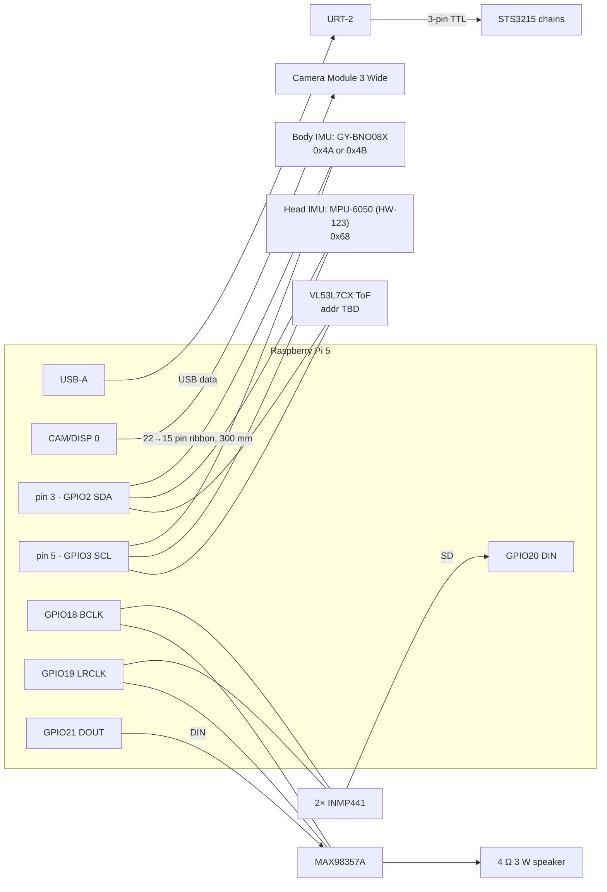

# Wiring and pinout

Power wiring is in [power.md](power.md). This page covers signals.



## Pi 5 assignments

| Interface | Connection | Pins / device | Status |
|---|---|---|---|
| Power in | USB-C | 5 V from the regulator pigtail | Decided |
| Servo bus | Pi USB-A → URT-2 USB-C (CH343 chip), cable through the neck | `/dev/ttyACM*`, 1 Mbaud Feetech STS | Decided. Confirm the device node on your Pi. |
| Camera | CSI | CAM/DISP 0 (CAM/DISP 1 is free for a future arm camera) | Decided |
| I2C | IMU + ToF, 400 kHz | pin 3 SDA (GPIO2), pin 5 SCL (GPIO3), pin 1 3.3 V, pin 6 GND | Standard pins |
| I2S | 2 mics + amp | GPIO18 BCLK, GPIO19 LRCLK, GPIO20 DIN, GPIO21 DOUT | Standard pins; overlay TBD ([audio.md](audio.md)) |
| Wi-Fi | 5 GHz to base station | onboard | Decided |
| Other GPIO | — | — | Free |

## I2C devices

| Device | Address | Power | Notes |
|---|---|---|---|
| IMU, body | GY-BNO08X (BNO080/085, 9-DoF with on-chip fusion): 0x4A or 0x4B, check the board | 3.3 V | Proposed. Mount flat near the body centre. Its I2C runs up the neck to the Pi. |
| IMU, head | HW-123 (MPU-6050, 6-DoF): 0x68 (0x69 with AD0 high) | 3.3 V on VCC (the board has its own regulator) | Proposed. Near the Pi. No address clash with the BNO08X. |
| VL53L7CX ToF | TBD (the VL53L5CX was 0x29) | **3.3 V**, so the I2C lines stay at 3.3 V | An 8×8 close-range "whisker" sensor, reliable to ~1 m. On hand; board maker to identify. |

Enable I2C at 400 kHz in `/boot/firmware/config.txt`:

```ini
dtparam=i2c_arm=on
dtparam=i2c_arm_baudrate=400000
```

## Servo bus

- STS3215 servos use a 3-pin connector (GND, V+, data) and daisy-chain.
- Run **two chains** from the URT-2's two TTL ports: one for rear and front, one up the neck for the neck and head.
- New servos all ship as **ID 1**. Plug them in **one at a time** to give each a new ID. See [servo_map.md](servo_map.md).
