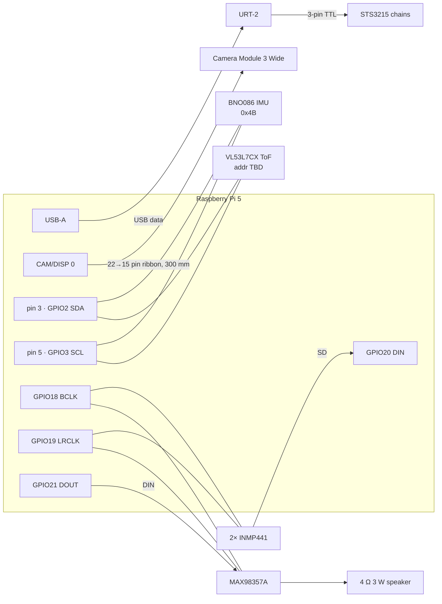

# Wiring and pinout

Power wiring is in [power.md](power.md). This page covers signals.



## Pi 5 assignments

| Interface | Connection | Pins / device | Status |
|---|---|---|---|
| Power in | USB-C | 5 V from the regulator pigtail | Decided |
| Servo bus | USB-A → URT-2 (CH343 chip) | `/dev/ttyACM*`, 1 Mbaud Feetech STS | Decided. Confirm the device node on your Pi. |
| Camera | CSI | CAM/DISP 0 (CAM/DISP 1 is free for a future arm camera) | Decided |
| I2C | IMU + ToF, 400 kHz | pin 3 SDA (GPIO2), pin 5 SCL (GPIO3), pin 1 3.3 V, pin 6 GND | Standard pins |
| I2S | 2 mics + amp | GPIO18 BCLK, GPIO19 LRCLK, GPIO20 DIN, GPIO21 DOUT | Standard pins; overlay TBD ([audio.md](audio.md)) |
| Wi-Fi | 5 GHz to base station | onboard | Decided |
| Other GPIO | — | — | Free |

## I2C devices

| Device | Address | Power | Notes |
|---|---|---|---|
| SparkFun BNO086 (Qwiic) | **0x4B** (not 0x4A like the Adafruit BNO085) | 3.3 V | Mount flat near the body centre. Qwiic-to-female jumpers mean no soldering. |
| VL53L7CX ToF | TBD (the VL53L5CX was 0x29) | **3.3 V**, so the I2C lines stay at 3.3 V | An 8×8 close-range "whisker" sensor, reliable to ~1 m. Exact breakout board TBD. |

Enable I2C at 400 kHz in `/boot/firmware/config.txt`:

```ini
dtparam=i2c_arm=on
dtparam=i2c_arm_baudrate=400000
```

## Servo bus

- STS3215 servos use a 3-pin connector (GND, V+, data) and daisy-chain.
- Run **two chains** from the URT-2 (body and head). If your URT-2 has only one TTL socket, split it with a Y-lead.
- New servos all ship as **ID 1**. Plug them in **one at a time** to give each a new ID. See [servo_map.md](servo_map.md).
